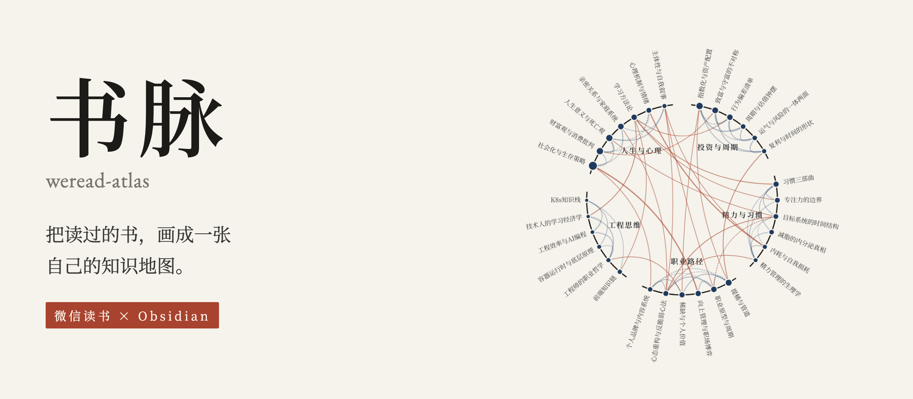
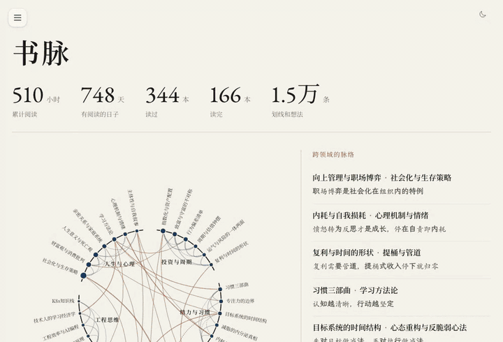
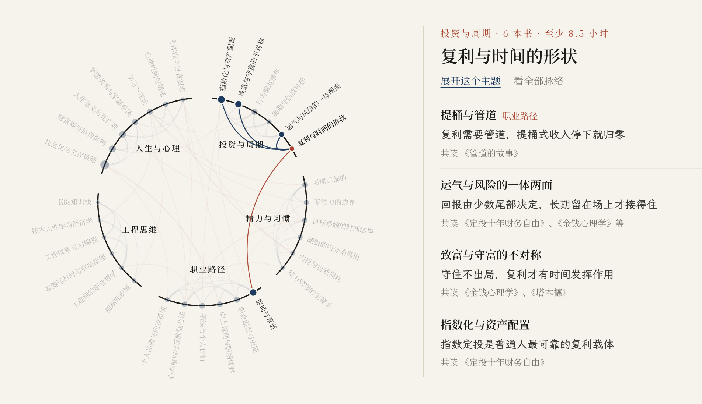
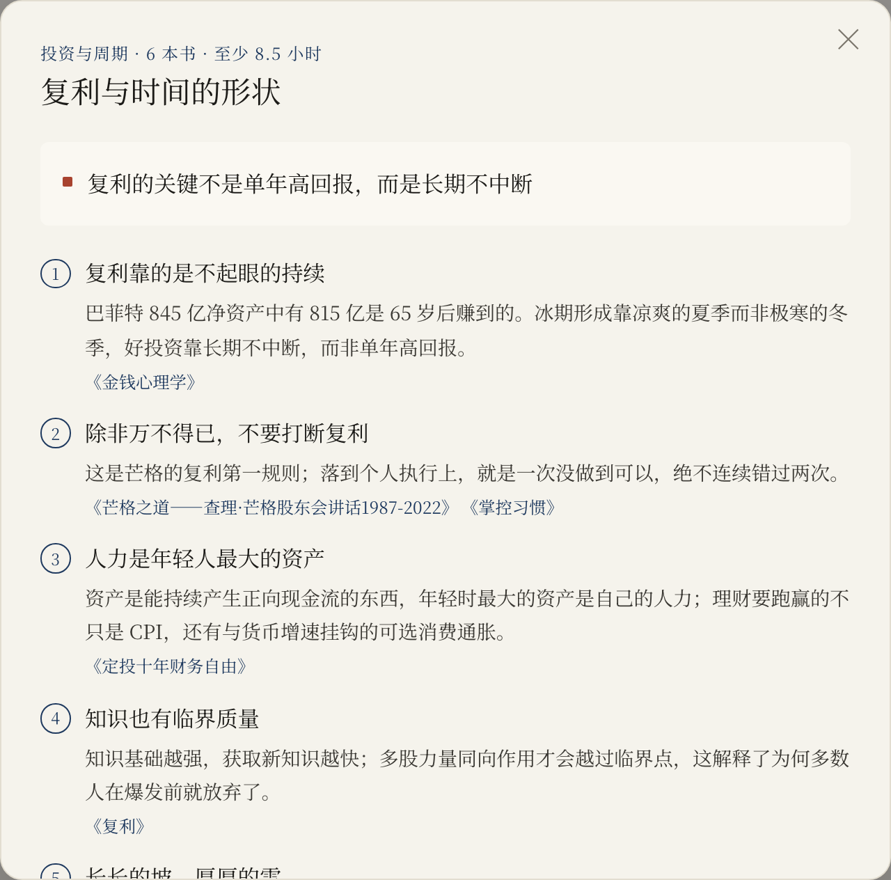
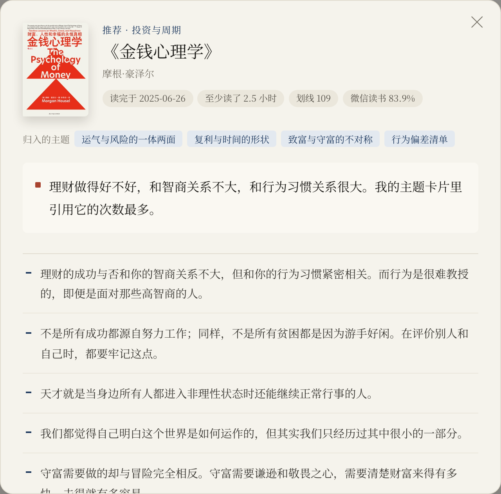
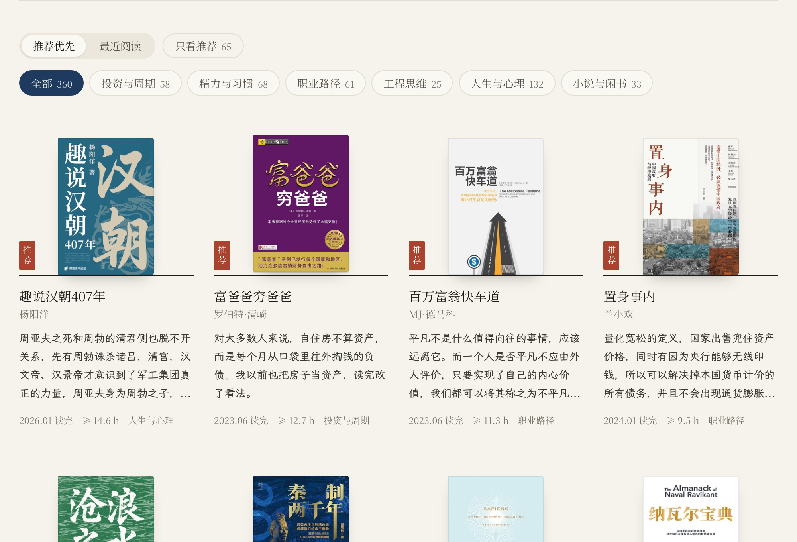
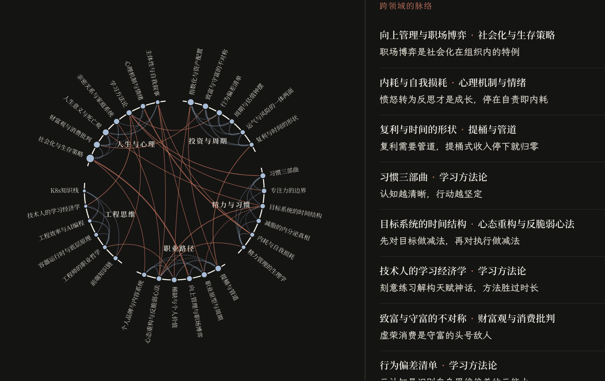
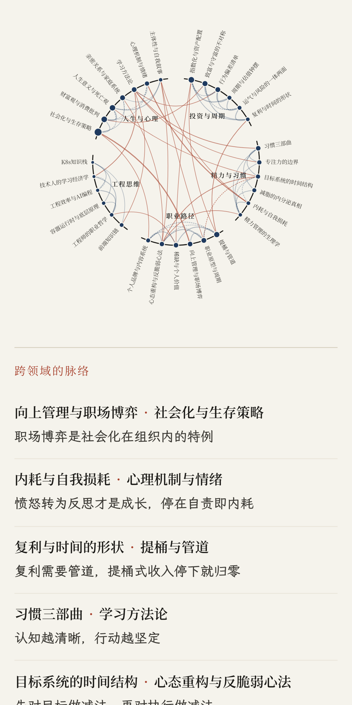
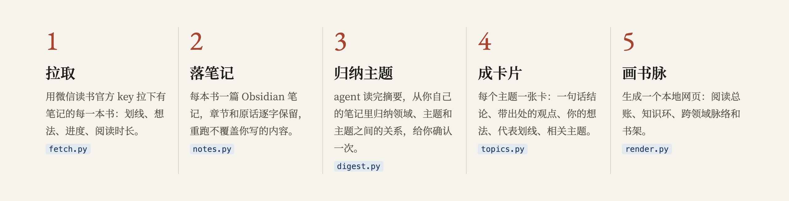

<p align="center"></p>

<p align="center">
  <a href="README_EN.md">English</a> · 中文
  <br><br>
  
  
  
  
</p>

书脉是一个 agent skill。它从微信读书拿到你的划线和想法，在 Obsidian 里按主题重新组织：每本书一篇笔记，跨书归纳出的主题各成一张卡片，卡片上的每条观点都链回出处，主题和主题之间写明为什么相连。最后生成一个本地网页，把你读过的书画成一张知识地图。

知识不按书存放，按主题存放。同步笔记只是第一步。

<p align="center"></p>
<p align="center"><sub>演示用的是作者自己的书脉：<a href="https://www.charles-cheng.com/books">charles-cheng.com/books</a> · <a href="assets/demo.mp4">高清视频</a></sub></p>

## 一张知识地图



- **知识环**：每个领域占圆环上的一段弧，每个主题是环上的一个点，读得越久点越大。

- **脉络**：主题之间的联系从环内穿过。跨领域的联系用朱红标出，一眼就能看到哪些领域互相贯通。

- **脉络栏**：右边一栏默认列出所有跨领域的联系和理由。点某个主题，就换成它和谁相连、为什么相连、共读过哪几本书。

## 每个主题一张卡片

<table>
  <tr>
    <td width="50%"></td>
    <td width="50%"></td>
  </tr>
  <tr>
    <td><sub>主题卡片：一句话结论，几条跨书的核心观点，每条都标出出自哪本书。</sub></td>
    <td><sub>书：你当时写下的想法原话和划线，点出处就能在书和主题之间来回跳。</sub></td>
  </tr>
</table>

这些内容同样写在你的 Obsidian 库里：

```
你的库/微信读书/
  总览.md          领域、主题和阅读统计的入口
  书/              每本有笔记的书一篇，章节、划线、想法逐字保留
  主题/            每个主题一张卡片：一句话结论、核心观点、我的想法、代表划线、相关主题
  书房/index.html  本地网页，双击即可打开
```

在 Obsidian 里打开关系图谱，书和主题会连成一张网。

## 也是一间书房



页面上还有阅读总账、每年和每月的阅读时长、一天里的阅读时段、阅读偏好的六维图，以及按领域筛选的书架。页面跟随系统切换深色模式，手机上也能看。

<table>
  <tr>
    <td width="62%"></td>
    <td width="38%"></td>
  </tr>
</table>

## 它是怎么做出来的



脚本只做确定性的工作：拉数据、写文件、渲染页面。需要判断的工作交给你自己的 agent：读完你的笔记，归纳领域、主题和主题之间的关系，写一句话结论，提炼观点。主题方案会先给你确认一次再落盘。

- 主题从你自己的笔记里长出来，不套固定分类。

- 首次运行先处理笔记最多的 50 本。几百本书的账号大约半小时能看到地图：拉数据 10 分钟左右，归纳主题十几分钟。其余的书之后分批补齐。

- 重复运行只更新生成区块，你在笔记里写的其他内容保持原样。

## 安装

1. 安装微信读书官方 skill：对你的 agent 说 `Download https://cdn.weread.qq.com/skills/weread-skills.zip and install the skill`。

2. 到 https://weread.qq.com/r/weread-skills 登录，复制 `wrk-` 开头的 API Key，然后 `export WEREAD_API_KEY=wrk-...`。Key 只放在环境变量里。

3. 把本仓库放进你的 agent 的 skills 目录，例如：

   ```bash
   git clone https://github.com/anneheartrecord/weread-atlas ~/.claude/skills/weread-atlas
   ```

   Codex 用 `~/.codex/skills/`，其他支持 skill 的 agent 放进各自的 skills 目录。

只需要 Python 3.9 或更高版本，不依赖任何第三方库。

## 使用

对 agent 说：

> 把我微信读书的笔记按主题整理进 Obsidian，再画一张我的知识地图。

agent 会先找到你的 Obsidian 库，然后依次拉数据、写笔记、归纳主题，把方案给你确认一次，最后生成页面。之后说“更新书脉”就会增量同步。

完整流程、默认值和注意事项写在 [SKILL.md](SKILL.md)，文件格式见 [references/vault-format.md](references/vault-format.md)。

## 隐私

数据只在你本机：脚本只调用微信读书官方接口，结果只写进你的 Obsidian 库。页面默认会显示你的想法原话。打算部署到网上或发给别人之前，让 agent 做一次分享前检查：它会列出涉及金额、年龄、家人、公司、健康等内容的想法，以及你自己上传的文稿，由你决定隐藏哪些。隐藏的内容只是不上页面，库里的笔记不变。部署时只上传 `书房/index.html` 这一个文件。

## 已知限制

- 只包含有笔记的书。读过但没有划线的书不会出现。

- 单本书的阅读时长只能算下限：接口只给出每月读得最多的前 10 本。

- 首次拉取几百本书需要 10 到 20 分钟。接口不支持并发，之后的增量更新只需要几秒。

- 评测和审查的过程、各轮结果和还没修的问题，记在 [docs/review-log.md](docs/review-log.md)。

## 许可

[MIT](LICENSE)
