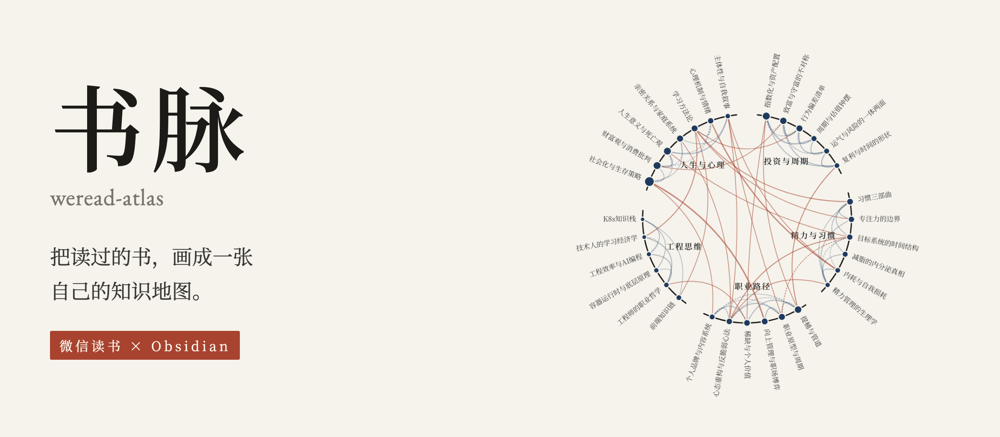
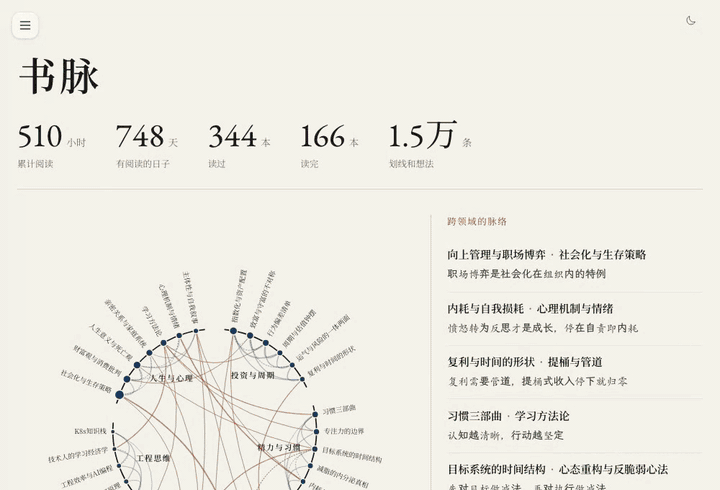
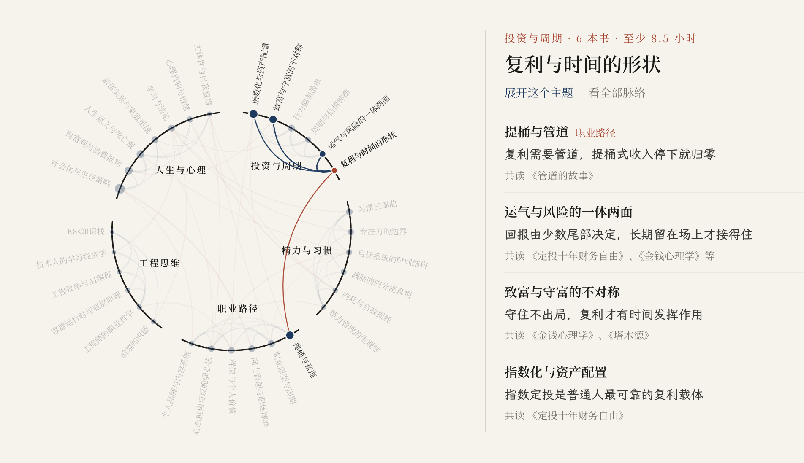
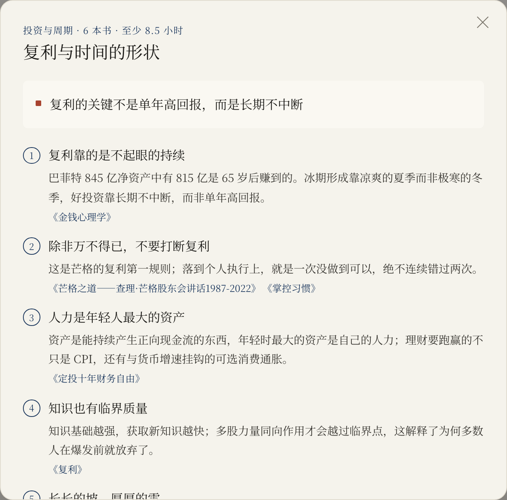
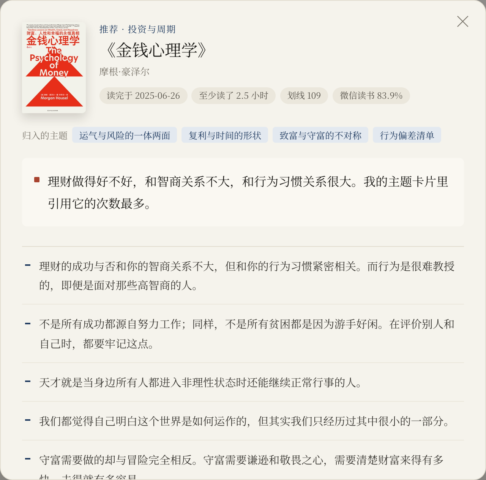
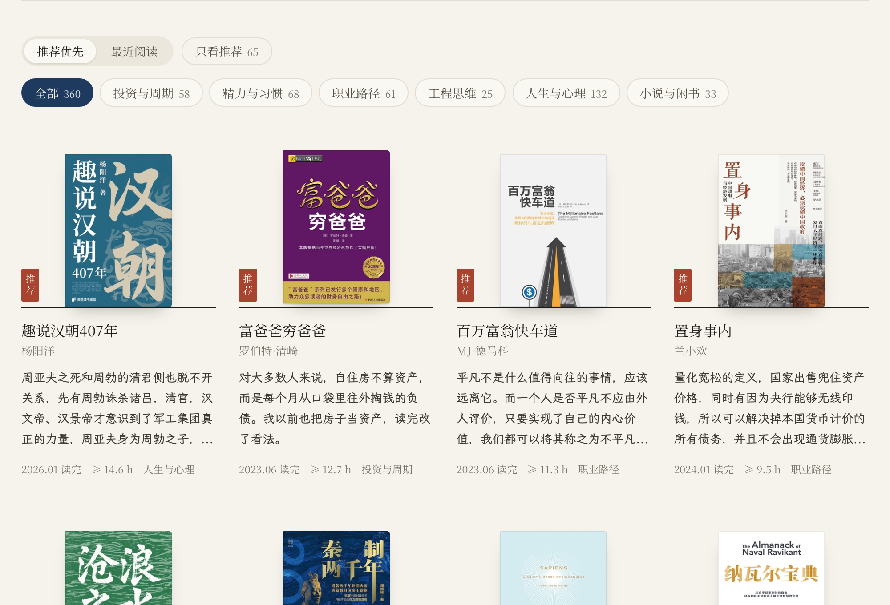
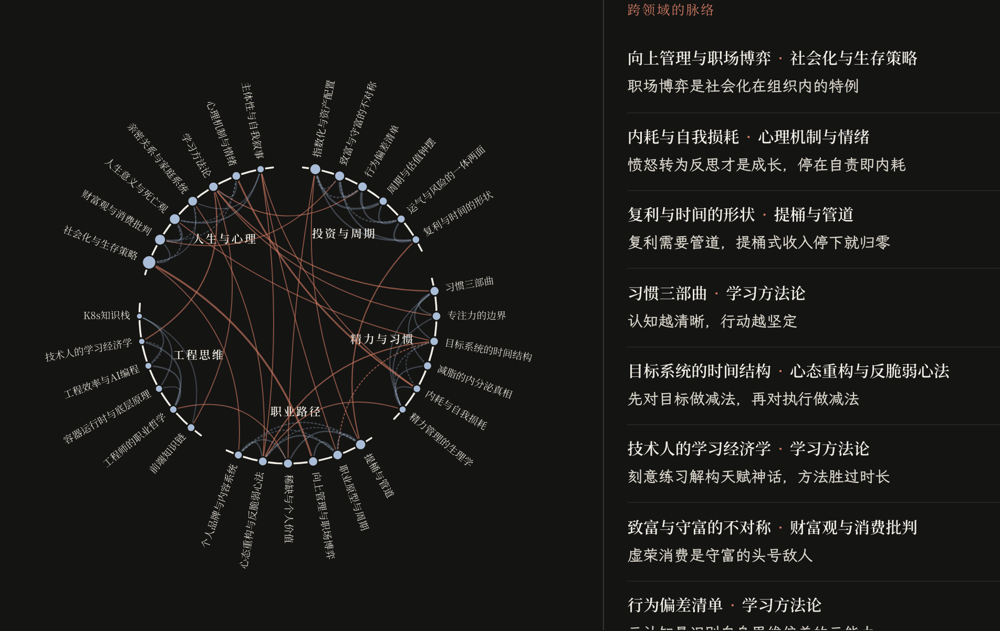
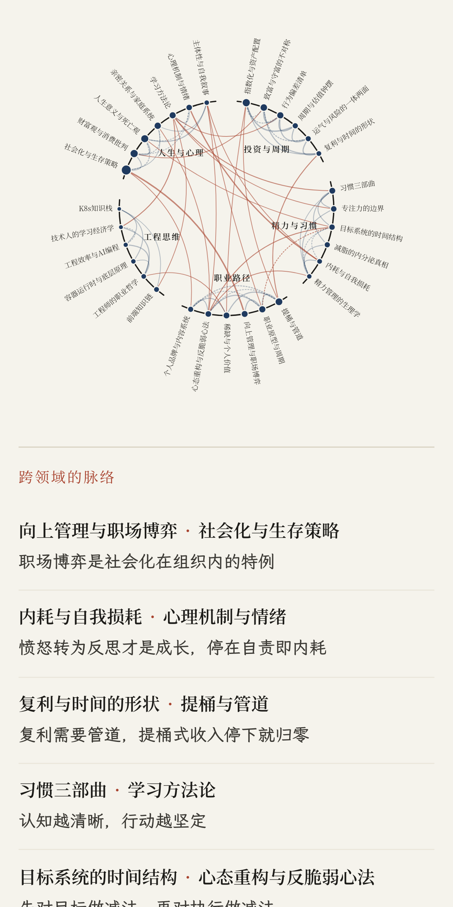
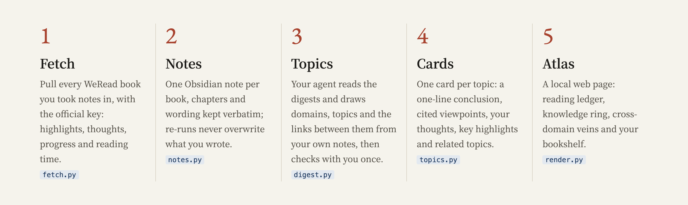

<p align="center"></p>

<p align="center">
  English · <a href="README.md">中文</a>
  <br><br>
  
  
  
  
</p>

weread-atlas (书脉) is an agent skill. It pulls your highlights and notes from WeRead (微信读书) and reorganises them in Obsidian by topic. You get one note per book and one card per topic, drawn across books. Every viewpoint on a card links back to its sources, and each card says how its topic connects to the others. It then renders a local page that draws everything you have read as a map of what you know.

Knowledge is filed by topic, not by book. Syncing the notes is only the first step.

<p align="center"></p>
<p align="center"><sub>The demo is the author's own atlas: <a href="https://www.charles-cheng.com/books">charles-cheng.com/books</a> · <a href="assets/demo.mp4">HD video</a></sub></p>

## A map of what you know



- **The ring:** each domain holds an arc of the circle and each topic is a point on it. The longer you read, the bigger the point.

- **The veins:** links between topics run across the ring. Links that cross domains are drawn in cinnabar, so you see at a glance which areas of your reading feed each other.

- **The veins panel:** by default it lists every cross-domain link with its reason. Pick a topic and it shows what that topic connects to, why, and which books they share.

## One card per topic

<table>
  <tr>
    <td width="50%"></td>
    <td width="50%"></td>
  </tr>
  <tr>
    <td><sub>A topic card: a one-line conclusion, then viewpoints drawn across books, each citing where it comes from.</sub></td>
    <td><sub>A book: your own thoughts and highlights, verbatim. Sources link both ways between books and topics.</sub></td>
  </tr>
</table>

The same content lives in your Obsidian vault:

```
your-vault/微信读书/
  总览.md          overview: domains, topics and reading stats
  书/              one note per book with notes; chapters, highlights and thoughts kept verbatim
  主题/            one card per topic: conclusion, viewpoints, your thoughts, key highlights, related topics
  书房/index.html  the page; open it with a double click
```

Open Obsidian's graph view and books and topics form one network.

## Also a reading room



The page also carries a reading ledger, reading time by year and month, the hours of the day you read, a six-axis chart of your reading preferences, and a bookshelf you can filter by domain. It follows your system's dark mode and works on a phone.

<table>
  <tr>
    <td width="62%"></td>
    <td width="38%"></td>
  </tr>
</table>

## How it works



The scripts do the deterministic work: fetching, writing files, rendering the page. The judgment goes to your own agent: it reads your notes and works out domains, topics and the links between them, writes each one-line conclusion and draws out the viewpoints. You confirm the topic plan once before anything is written.

- Topics grow out of your own notes, not out of a fixed taxonomy.

- The first run covers the 50 books with the most notes. An account with a few hundred books gets its map in about half an hour: roughly 10 minutes to fetch and 15 to work out topics. The rest can be added in batches.

- Re-runs only rewrite the generated block. Anything else you write in a note stays where it is.

## Install

1. Install the official WeRead skill. Tell your agent: `Download https://cdn.weread.qq.com/skills/weread-skills.zip and install the skill`.

2. Sign in at https://weread.qq.com/r/weread-skills, copy your API key (it starts with `wrk-`), then run `export WEREAD_API_KEY=wrk-...`. Keep the key in the environment only.

3. Put this repository in your agent's skills folder, for example:

   ```bash
   git clone https://github.com/anneheartrecord/weread-atlas ~/.claude/skills/weread-atlas
   ```

   Codex uses `~/.codex/skills/`. For any other agent that supports skills, use its own skills folder.

It needs only Python 3.9 or later and no third-party packages.

## Use

Tell your agent:

> Organise my WeRead notes into Obsidian by topic and draw me a map of what I've read.

The agent finds your Obsidian vault, fetches your data, writes the book notes and works out topics. It shows you the plan once, then renders the page. Later, "update my atlas" syncs only what changed.

The full workflow, defaults and caveats are in [SKILL.md](SKILL.md). The file formats are in [references/vault-format.md](references/vault-format.md).

## Privacy

Your data stays on your machine. The scripts call only the official WeRead API and write only into your Obsidian vault. The page shows your thoughts verbatim by default. Before you deploy it or share it, ask the agent for a share check. It lists thoughts that mention money, age, family, employers, health and the like, plus any of your own uploaded drafts, and you choose which to hide. Hidden items are left off the page only; your notes are untouched. Deploy just `书房/index.html`.

## Known limits

- Only books with notes are included. Books you read without highlighting anything do not appear.

- Per-book reading time is a lower bound, because the API only reports each month's top 10 books.

- The first fetch of a few hundred books takes 10 to 20 minutes because the API does not allow parallel calls. Later updates take seconds.

- How the skill is evaluated and reviewed, the results of each round and the issues still open are in [docs/review-log.md](docs/review-log.md) (in Chinese).

## License

[MIT](LICENSE)
